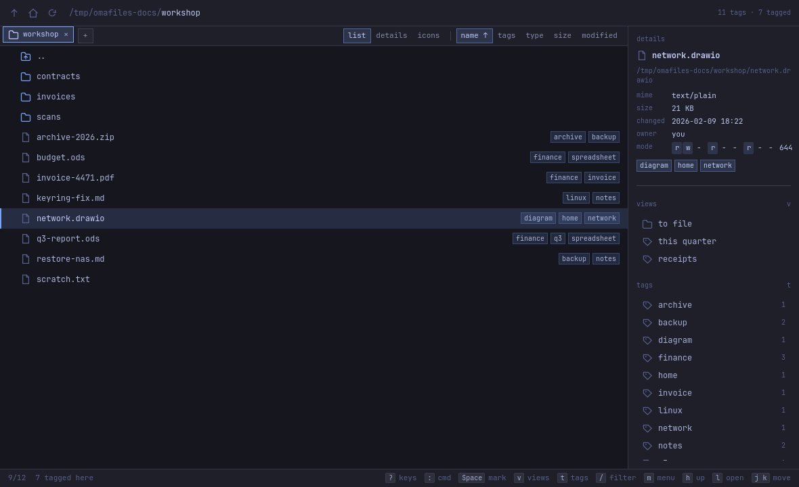
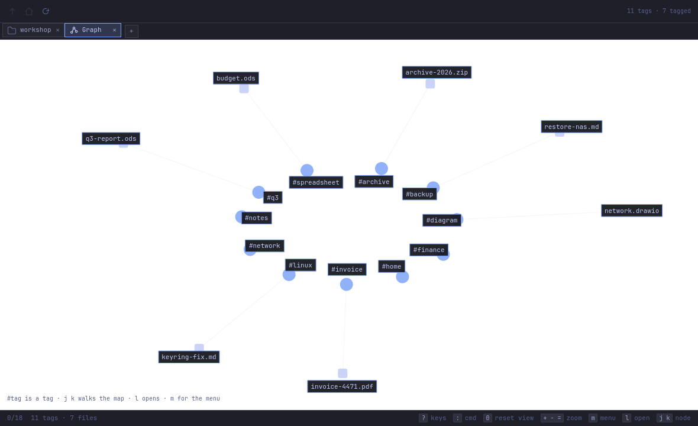
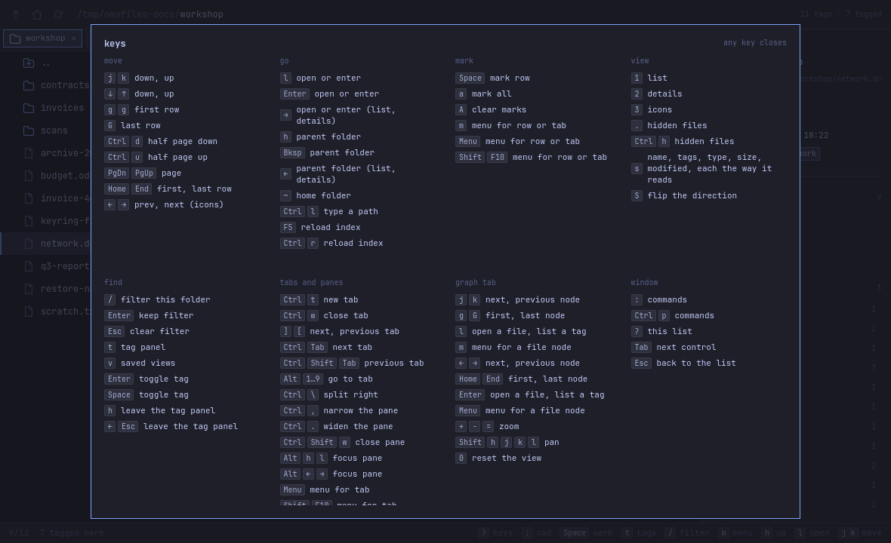
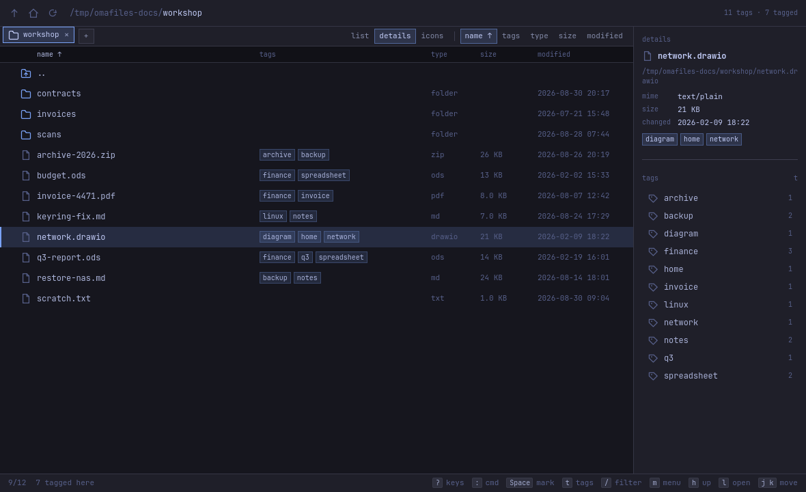

# omafiles

Tags on files, from a command line and a Qt Quick window over the same text
index. Nothing is moved, renamed or wrapped — the filesystem stays the
filesystem.




## Build

From a checkout:

```bash
mise install
mise run deps      # Qt 6 + qmake
mise run build     # build/bin/omafiles and build/bin/omafiles-studio
mise run studio    # open the window
```

Released under the MIT license. `pkgbuild/omafiles.desktop` and `pkgbuild/omafiles.svg`
are the desktop entry and icon. The Arch recipe is in the sibling `omarchy-pkgs` repo
at `pkgbuilds/omafiles`; it installs `omafiles` and `omafiles-studio`. There is no
tagged tarball yet, so that PKGBUILD's `sha256sums` is `SKIP` until v0.1.0.

## Tagging

```bash
omafiles tag add --tag work --tag finance -- ~/docs/invoice.pdf
omafiles tag ls -- ~/docs/invoice.pdf
omafiles ls --tag work --tag 2026        # both tags
omafiles ls --any invoice --any tax      # either tag
omafiles ls --untagged ~/docs            # files and folders with no tags
omafiles tags
```

Tags are folded to lower case and have to spell `[a-z0-9-]`, so `Work` is filed,
listed, counted and completed as `work`. A word that will not fold into that
shape — `my tag`, `under_score` — is refused rather than bent into one.

Paths are taken as written — no `~` and no `$VAR` expansion of its own. Flags
come first and paths after `--`, so `-weird.pdf` is a path and not a flag.
`--json`, `--dry-run`, `--yes` and `--quiet` are taken by every verb, each with
a one-letter short form and, `--quiet` apart, an environment variable behind it;
`-h` and `-V` are there too. The one exception is `completions`: it prints a
shell script, which has no `--json` shape to give, so it refuses the flag rather
than taking it and ignoring it — while still reading an `OMAFILES_JSON` in the
environment as the default it is, so `source <(omafiles completions bash)` works
in a shell that exports one.

`--quiet` never hides an error. What it takes away is a note beside a success:
a filesystem that would not carry the tags onto the file itself, on a verb that
exits 0 anyway because the row is the record. `--dry-run` makes every refusal
the program decides for itself, and makes it before it asks, so a prompt never
names a path the run will then refuse; it commits nothing and takes no write
lock, so it runs wherever `ls` runs. What it does not do is guess at the
filesystem: whether a `user.*` write is taken can only be found out by making
the write, so `--dry-run reindex` over a file whose xattr is refused prints the
path and exits 0 where the real run exits 1. Which verbs draw those two lines
where is in [the command line](docs/cli.md).

Exit codes are 0 for a run that did what was asked, 1 for a refusal or a usage
error, 2 for a path that is not there and 3 for an index that could not be read
or written. The one worth reading twice is 1, because it also covers an answer
the run could not finish: a list one row short, because the system would not
describe a path, exits 1 rather than passing the row over and looking complete.
`has` spends 1 on a plain no, the way `grep` does. [The command
line](docs/cli.md) has the whole table.

A path has to be text. The jsonl index is UTF-8 by definition and so is an
xattr value, so a filename holding bytes that are not valid UTF-8 belongs to
neither: every verb handed one reports it as `path missing` with the name
mangled rather than acting on the wrong file, and a walk that meets one says so
instead of stepping over it. `mv` and `rm` from coreutils handle those names;
this does not, and the failure is the safe one. Rename the file, or use the
tools that work in bytes.

The text output is tab-separated, so it cannot spell a path holding a tab or a
newline: a tab in a name reads as the separator between fields, a newline ends
the line, and nothing escapes either. `--json` is the form that can — a tab
there is written `\t`, a newline `\n` and a backslash `\\`, so neither of the
first two can be forged and a row stays one line whatever a file carries.
Neither form is the bytes themselves: a name, or an xattr value, that is not
valid UTF-8 is printed with what cannot be decoded as U+FFFD, in both.

Neither `mv` nor `cp` will write over something already at the destination,
which is where the two part company with coreutils: a clobbered file takes its
index row and its tags with it, and nothing here can put them back. Move it out
of the way, or `rm` it, first — and a dangling symlink counts as something being
there, because a symlink is the link it is to the verbs that act on a name.
`rm`, `trash` and `mv` act on the name; `cp` and every `tag` verb read through
it and mean the file at the far end.

Move something with `mv` and the index follows it — a folder takes the rows of
everything inside it, as long as it stays on the same filesystem: a folder is
renamed and never copied, so `omafiles mv dir /mnt/elsewhere` is refused rather
than half done. A single file does cross, as a copy and a delete, and a symlink
crosses as the link it is whatever it points at. What that copy does not carry
is the file's modification time or any `user.*` xattr but its tags — use
coreutils `mv` when those matter. Move something with anything else, or across
filesystems, and those rows go stale, which is what `prune`, `reindex` and
`verify` are for.

```bash
omafiles mv ~/docs/invoice.pdf ~/archive/     # the file and its tags
omafiles mv ~/docs ~/archive/docs             # the folder and every tag under it
omafiles has --tag work -- ~/docs/a.md && echo yes
omafiles tag merge finanace finance           # fix a typo across the index
omafiles verify ~/docs                        # exit 1 if index and disk disagree
omafiles reindex --from-xattr ~/docs          # rebuild rows from the files' tags
omafiles recent 10                            # last ten things you tagged
```

Many changes at once cost one read and one write, and roll back together if any
line fails:

The heredoc below is unquoted on purpose, so the shell expands the paths before
omafiles ever sees them:

```bash
omafiles batch <<EOF
tag add --tag work -- $HOME/docs/a.pdf
tag add --tag work --tag finance -- "$HOME/docs/b with space.pdf"
tag clear -- $HOME/old/draft.md
EOF
```

A line that fails takes the whole run with it and exits with that line's own
code. A line that runs to the end and still does not settle everything it was
asked to — a `reindex` over a file whose xattr the filesystem refuses — is not
that: the rows landed, the commit stands, and the batch exits 1 the way the line
would have on its own.

A line is one write verb and its own flags, split into words the way a shell
splits them and no further. Nothing is expanded — no `$VAR`, no `~`, no globbing
— which is why the heredoc above is unquoted. `batch` will not nest, will not
run a verb that only reads, and will not run `rm`, `mv`, `cp` or `trash`,
because a rolled back index cannot bring a deleted file home; the globals belong
to the batch and go before it. A `#` in the first column is a comment; past that
column it is an ordinary character, so `-- c.txt # a note` hands the verb three
operands and fails on the second. [The command
line](docs/cli.md#omafiles-batch) has the rest of the rules, quoting included.

`export` writes one index row per line and `import` merges one back, so the
pair is a pipe: `omafiles export | ssh box omafiles import -`, where `-` is
stdin the way it is for `batch`. A merge and not a replacement — the rows the
dump does not mention are left alone, so restoring one machine's tags onto
another is not a way of losing the second machine's. `import` reads either shape
`export` writes, so the pipe holds in a shell that exports `OMAFILES_JSON`.

Completion offers your own tags, because it asks the index:

```bash
source <(omafiles completions bash)     # or zsh, or fish
omafiles ls --tag <TAB>                 # finance  quarto  work
```

Every verb in [the command line](docs/cli.md) is built.

Tags live in two places: the index row and the file's own `user.omafiles.tags`.
So a file moved by something else — a shell, a file manager — keeps its tags,
and the index catches up:

```bash
omafiles verify ~/docs            # missing: the old path, unindexed: the new one
omafiles reindex ~/docs           # reads the file's own tags, writes the new row
omafiles prune ~/docs             # drops the row that points nowhere
```

`verify` prints one problem per line — the kind, the path, and a detail where
there is one — and exits 1 if it found any, the way `diff` does. The kinds are
`missing`, `unindexed`, `xattr-differs`, `xattr-unreadable`, `xattr-invalid` and
`unreadable`; [the command line](docs/cli.md#omafiles-verify) says which command
settles each, because naming the repair is the point of the verb, and it is also
where the escaping rules for that text form are. `--json` is the shape to parse.

`prune` means the directory you name, or the one you are standing in. `--all` is
the whole index, and it asks first either way.

`--ext` asks about files: a directory named `notes.bak` is not what `ls --ext
bak` was asked for, so it is left out, and `--untagged --ext bak` leaves it out
too. A row whose file is gone is left out as well rather than listed as a path
that is not there — `verify` reports that one as `missing` and `prune` drops the
row.

`--since` counts from when a path was **tagged**, not when the file was touched.
A row written before the index recorded that cannot answer; `ls` says how many
of the rows it would otherwise have returned were skipped for that reason,
rather than quietly returning a short list. `--untagged` refuses `--since` and
`--tag` outright: a file with no tags was never tagged and matches no tag, so
those flags could only empty the answer.

## Shortcuts

The window says what its keys are. `?` draws the whole map over it — marks,
sort, views, hidden files and tabs live there, not repeated below — and the bar
along the bottom names the few that matter wherever the keyboard is — so the
reference is in the program rather than in a file you have to go and find. What
is below is the list's first handful: `j` and `k` move, `l` and `Enter` open a
file or enter a folder, `h` goes back up, `t` hands the keyboard to the tag
panel, `/` filters the folder and `:` opens the commands. Some of those mean
something else where the keyboard is somewhere else, and the sheet says which.
`Esc` always hands the keyboard back to the list.



The table view puts the tags beside the size and the date, and the right-hand
panel answers about whatever the cursor is on:



Picking a tag in the dock lists every file that carries it, wherever it is in
the index — the same answer as `omafiles ls --tag`. With no tag chosen, the
list is the folder.

## What the window says

The list is the folder, so a folder it could not read is not an empty one. One
nobody may open, one that is not there and one that is genuinely empty are three
different answers, and the status line says which: `Permission denied`, `path
missing`, or nothing at all. Either of the first two still lists `..`, so `h` and
`Enter` walk out of a folder that was deleted or shut under you.

A dangling symlink, a symlink that points round to itself and a fifo are all
things the folder holds, so all three are listed. The type column calls the first
two `broken link` and anything that is neither a file nor a folder `special`; the
panel on the right carries the exact type. Opening a broken link names both ends
of it, the way `omafiles open` does. A fifo, a socket or a device is not handed
to the desktop at all — a read of one may never return — and the status line says
that is why nothing happened.

A name whose bytes are not valid UTF-8 is not listed. Qt drops the entry before
the window sees it, and a path here is text either way: a row for one could not
be turned back into the name on disk, so every key pressed on it would act on the
wrong file or on none. What the window does instead is read the directory again
in bytes, the way `ls --untagged` and `reindex` do, and name it on the status line
mangled rather than passing over it. Rename the file, or use the tools that work
in bytes.

`N tags · N tagged` in the header counts the index rows the system will describe
— the same rows `omafiles ls` and `omafiles tags` answer with, and the same rows
the tag panel and the graph are drawn from. Where that count came up short the
status line says so, because the window has no exit code to spend on it the way
the command line does. An index with rows in it and nothing reachable is not an
index with nothing tagged, so the graph names the repair that state wants:
`omafiles prune` where the files are gone, `omafiles verify` where the system is
only declining to describe them.

Tags are also written to the file's `user.omafiles.tags` xattr where the
filesystem allows it, as a comma-separated list, so a copy that preserves
attributes carries them along and a tree can be rebuilt from the files alone.
The index at `$XDG_DATA_HOME/omafiles/index.jsonl` stays the source of truth: a
filesystem that will not take the xattr says so and `tag add` still exits 0,
because the row is the record. The window follows that file and reloads when the
command line writes to it.

Colours come from the current omarchy theme and the corner rounding from
hyprland's `looknfeel.lua`, both live — `omarchy theme set` recolours the window
without a restart, and a `decoration.rounding` you change is the window's next
corner.

## The graph

A graph tab draws the index as a map: a node per tag, and every tagged file
hanging off its rarest tag, which is the one that says the most about it. `j`
and `k` walk the nodes, `l` opens the file under the cursor or lists the files
carrying the tag under it, `m` is a file node's menu, `=` and `-` zoom and `0`
puts the view back. The lines you see at rest are the branches; a file's other
tags and the tags it shares a file with are drawn around whatever you point at,
because drawing all of them at once is a ball of string and not a map.

It draws at most three hundred files. Every graph view has a ceiling — past a
few hundred names the rings run into each other whatever the layout does — and
the tools that publish a number put it in the same place: Neo4j Browser ships
`initialNodeDisplay` at 300, Kibana's Graph adds five terms a hop, GitHub's
network graph takes the hundred most recent branches. What is not settled is
saying so, which most of them do not. The status line here always names both
counts — `7 tags · 7 files`, or `7 tags · 300 of 512 files` where the index is
larger than one map — so the picture is never mistaken for the collection it is
a picture of.

The status line on a graph tab is about the graph: the node under the cursor of
the nodes there are, and those two counts. It has no folder to count, and the
folder's numbers read out there would be a confident `0/0` about an index with
files in it.

The list is live. The folder on screen is watched, so a file written, renamed or
deleted by anything else — another terminal, a download, `omafiles` in the window
next to this one — turns up in the list without a key being pressed. One
directory is watched and never a tree: an inotify watch is a per-user resource,
and what the list has to be honest about is the list. `F5` and `Ctrl r` go on
meaning what the key sheet says they mean, which is re-reading the index.

Marks belong to the tab. Two tabs in one pane are drawn by one list, so marks
held by the list would follow you across a switch and still be counted, still be
shown and still be what `A` clears — with another folder underneath them. Walking
a tab into a different folder ends its marks for the same reason: what `a` marks
and what a menu acts on is what is in front of you.

The item count beside a folder is every name it holds — hidden ones, the links
that lead nowhere, the fifos and the names no path here can spell — read through
the same reader the listing itself uses. A folder nobody may open gets no number
rather than a zero.

## Requirements

- Qt 6: `qt6-base`, `qt6-declarative`
- `xdg-utils` for `omafiles open`, which asks `xdg-mime` what the desktop would
  use and then hands the path to `xdg-open`; without it, `gio open` stands in.
  Every operand is resolved before any of them is launched — see [the command
  line](docs/cli.md#omafiles-open)
- `glib2` for `omafiles trash`, which hands the file to `gio` rather than
  reimplementing the desktop's wastebasket
- [mise](https://mise.jdx.dev/) for the tasks above

`docs/img` is regenerated from the studio itself with `mise run shots`.