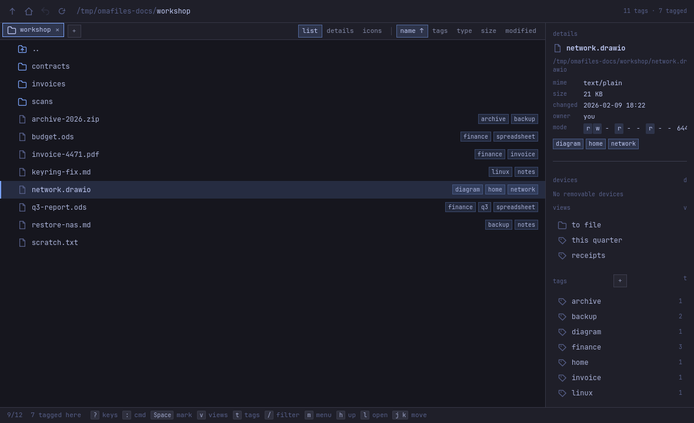
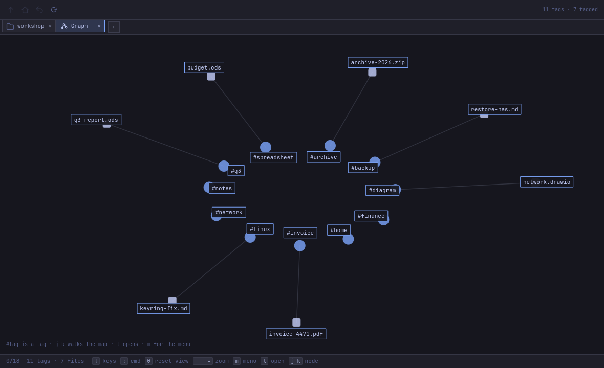
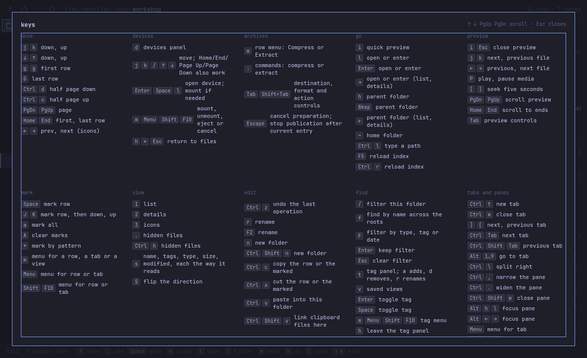

# omafiles

Tags on files with a CLI and a Qt Quick window over the same text index. Nothing is moved, renamed or wrapped — the filesystem stays the filesystem.





## Install

On Arch or Omarchy, x86_64:

```bash
curl -fsSL https://raw.githubusercontent.com/This-Is-NPC/omafiles/master/install.sh | bash
```

It downloads the latest release's package, checks it against the release's
`SHA256SUMS` and installs it with `pacman -U`; `sudo pacman -R omafiles` takes it
off again. [How to install and remove](docs/how-to-install-and-remove.md) covers
versions, a dry run and updates.

## Start here

- `j` / `k` — move the cursor
- `l` / `Enter` — open a file or enter a folder
- `h` — go back up
- `t` — tag panel
- `v` — saved views
- `/` — filter the folder

## Big ideas

**[Browsing](docs/browsing.md)** — folder names load in the background without waiting, with automatic refresh when files are created, deleted or renamed.

**[Tagging](docs/tagging.md)** — mark files with custom labels; the same file can have multiple tags; tags travel with the file in its xattr so other tools moving or copying do not lose them.

**[Preview](docs/preview.md)** — press `i` on a file to see its text, images, PDFs, or archive contents without opening another application.

**[Thumbnails](docs/thumbnails.md)** — image and video thumbnails from the desktop cache; custom thumbnailers for your own formats.

**[Trash](docs/trash.md)** — safe deletion to the desktop's trash; restore from there or erase permanently.

**[Undo](docs/undo.md)** — Ctrl+Z undoes file operations with a history visible in the window.

**[Conflicts](docs/conflicts.md)** — when copying or moving would overwrite, choose Replace, Skip, Keep both or apply to the rest of the batch.

**[Archives](docs/archives.md)** — compress to zip, tar.gz or tar.zst; extract these and other formats libarchive reads; tags stay with restored files.

**[Devices](docs/devices.md)** — list, mount and eject removable drives and phones; root declarations let tags follow storage to a new mount path.

**[File chooser](docs/file-chooser.md)** — other applications can ask omafiles to open or save files instead of using their built-in dialogs.

**[Drag and drop](docs/drag-and-drop.md)** — copy, cut, move and link files by dragging between the window, other file managers, and the desktop.

**[Desktop](docs/desktop.md)** — make omafiles the default file manager; integrate with browser "Show in folder" and application file-open requests.

**[CLI](docs/cli.md)** — the `omafiles` command reads and writes the same index as the window, with or without it open. A symlink is the link itself to `rm`, `trash` and `mv`, and its target to `cp` and the tag verbs.

## Interface



Full keyboard controls are documented in the sections above. Pointer actions work the same way: right-click or press-and-hold opens the row menu; drag in the list marks rows; drag files onto a folder to move them on the same device or copy them across devices, or hold Ctrl to copy, Shift to move, or Ctrl+Shift to link (see [Drag and drop](docs/drag-and-drop.md)).

## What it does not do

- Tagging does not move, rename or wrap files. Tags live in the file's extended attributes and in the index; the filesystem stays the filesystem.
- It does not open files itself. Opening hands off to the desktop's configured application; quick preview (`i`) shows a file in place without starting another program.
- It does not touch file contents. A tag write changes only the extended attribute and the index.
- It does not overwrite by default. `mv` and `cp` refuse an occupied destination by default; [conflict flags](docs/conflicts.md) make the choice explicit.
- It does not move files to the Trash itself. Trashing hands them to `gio trash`; omafiles then lists, restores and empties the Trash on its own.

## Known limitations

**Phones need GVfs backends.** Browsing Android phones requires `gvfs-mtp` or `gvfs-afc`; iPhones require `gvfs-afc`. Install the matching package for your phone, unlock it, and permit file access on the phone itself.

**GVfs FUSE bridge required.** Storage cannot be browsed without GVfs's FUSE bridge (`gvfs`), which must expose a local filesystem path. If a mount succeeds without the bridge, an explicit explanation appears instead of opening an invented path.

## Contributing

[docs/design.md](docs/design.md) is the page for contributors: how omafiles is built, checked and tested.

## Requirements

- Qt 6: `qt6-base`, `qt6-declarative`, `qt6-pdf`, `qt6-multimedia`
- `libarchive` for archive compression, extraction and previews
- `kwindowsystem` (KF6) for portal parent-window integration on Wayland and X11
- `xdg-utils` for `omafiles open`
- `glib2` for device monitoring and `omafiles trash`
- `udisks2` and `gvfs` for removable drives
- `xdg-desktop-portal` for system integration

## License

MIT. See [LICENSE](LICENSE) for details.
